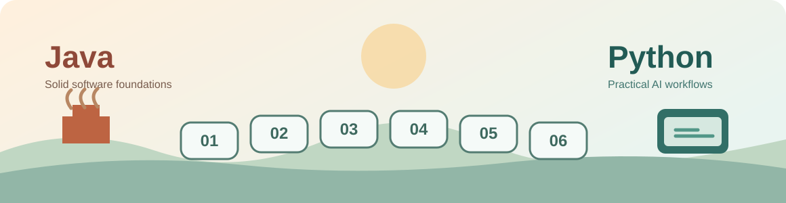

<p align="center"></p>

<h1 align="center">Python for Java AI Engineers</h1>
<p align="center"><strong>A Python language bridge for working Java developers who want to use Python in AI engineering.</strong></p>
<p align="center"><a href="https://github.com/fmemetaj/python-for-java-ai-engineers/actions/workflows/ci.yml"></a>  <a href="LICENSE"></a></p>

You already know Java, OOP, REST APIs, and tests. This repo teaches the Python-specific patterns that show up in AI projects. It is **not** a beginner programming course, a full ML course, or a conversion service. No paid API key is required for the core notebooks.

**Status:** Modules 0A and 0B (concepts 0.1–0.29) are in the repo, plus the original seven notebooks and an optional Gradio/Ollama lab. Later modules are planned — see [docs/planning](docs/planning/course-strategy.md).

## Start here

```bash
uv python install 3.12
uv sync --locked --group dev
uv run python scripts/doctor.py --offline
```

Then start **[Module 0A](modules/0a-fundamentals/README.md)** (or take the [placement check](placement/README.md) if you already know some Python), then **[Module 0B](modules/0b-fundamentals/README.md)**. Select the interpreter in this repository's `.venv`.

| I want to... | Go to |
| --- | --- |
| Start Module 0A (fundamentals 0.1–0.15) | **[Module 0A](modules/0a-fundamentals/README.md)** |
| Continue with Module 0B (0.16–0.29) | **[Module 0B](modules/0b-fundamentals/README.md)** |
| Skip 0A concepts I already know | [Placement check](placement/README.md) |
| Use the original notebooks as explainers | **[Lesson 00](notebooks/00_getting_started.ipynb)** |
| Fix install, PATH, kernels, proxy/SSL, WSL | **[Troubleshooting](docs/setup/troubleshooting.md)** |
| Use Cursor (optional AI tutor rules) | [Editor setup](guides/01_editor_setup.md#cursor) |
| Use VS Code or JupyterLab | [Editor alternatives](guides/01_editor_setup.md) |
| Try a local model in a small UI | [Optional Gradio + Ollama lab](guides/06_local_ai_lab.md) |
| Track lesson completion | [Progress checklist](PROGRESS.md) |
| Read the course plan | [docs/planning](docs/planning/course-strategy.md) |

Times below are **unmeasured estimates** for engineers who already know Java. They exclude install time and the optional lab. If a lesson took longer or shorter, please [tell us your time](.github/ISSUE_TEMPLATE/lesson-feedback.yml).

| Lesson | What you will learn | Est. |
| --- | --- | ---: |
| [Module 0A · Fundamentals I](modules/0a-fundamentals/README.md) | Concepts 0.1–0.15, Java-first or NEW, plus `log_stats` | ~8–9 h |
| [Module 0B · Fundamentals II](modules/0b-fundamentals/README.md) | Classes, typing, errors, decorators, asyncio; `tool_registry` | ~8–9 h |
| [00 · Getting Started](notebooks/00_getting_started.ipynb) | Notebook mechanics and Java mental model | ~3 min |
| [01 · Pythonic Essentials](notebooks/01_pythonic_essentials.ipynb) | Comprehensions, dictionaries, `None`, kwargs | ~9 min |
| [02 · OOP, Typing & Pydantic](notebooks/02_typing_pydantic.ipynb) | Dataclasses, types, runtime validation, decorators | ~12 min |
| [03 · Async & Streaming](notebooks/03_async_streaming.ipynb) | Coroutines, concurrent I/O, generators | ~12 min |
| [04 · Production Python](notebooks/04_production_python.ipynb) | Modules, `uv`, tests, context managers | ~9 min |
| [05 · Mini Workflow](notebooks/05_mini_ai_agent.ipynb) | Typed fake tools, async coordination, approval | ~12 min |
| [06 · Readiness Check](notebooks/06_readiness_check.ipynb) | Questions and executable checks | ~3 min |

Every notebook starts with **why it matters**, a short **Java example**, then the runnable **Python counterpart**. Completing a lesson means understanding the explanation and attempting the exercise, not only selecting Run All. Type hints are editor guidance, not runtime validation; Pydantic validates at input/output boundaries. `asyncio` is cooperative concurrent I/O, not automatic multithreading.

## Optional local AI lab

After the core notebooks, a small **support-ticket reply assistant** shows types, async code, HTTP, Gradio callbacks, and a simulated approval gate:

```bash
uv sync --locked --group dev --group demo
uv run --group demo python examples/gradio_app.py
```

Default mode is **Mock (no model)** — no API key, no Ollama. For local inference, install [Ollama](https://ollama.com/download), run `ollama pull llama3.2:1b`, and select **Ollama (local model)**. See [the lab guide](guides/06_local_ai_lab.md). **Approval is simulated only**; nothing sends email or updates a real ticket.

## Setup tips (Windows, macOS, Linux)

- **PATH:** after installing [uv](https://docs.astral.sh/uv/getting-started/installation/), restart the terminal *and* the editor. Prefer `uv run python` over a system `python`.
- **`python` not found:** on macOS/Linux use `python3` or `uv run python`. On Windows try `py -3.12`, not the Microsoft Store stub.
- **Jupyter kernel:** Command Palette → **Python: Select Interpreter** → `.venv`, then pick that kernel in the notebook. Cursor and VS Code both work; JupyterLab (`uv run jupyter lab`) works without an IDE.
- **Proxy / SSL / VPN:** uv uses `HTTPS_PROXY`. Corporate TLS inspection needs `SSL_CERT_FILE` pointed at your CA. A VPN can block PyPI; doctor warns if PyPI is unreachable.
- **Apple Silicon:** use an arm64 uv/Python. "Bad CPU type" means a Rosetta (x86_64) binary.
- **WSL:** run clone, uv, and notebooks entirely inside Linux. Do not mix a Windows `.venv` with WSL paths.

Full detail: [docs/setup/troubleshooting.md](docs/setup/troubleshooting.md).

## Guides (read only when needed)

1. [Editor configuration](guides/01_editor_setup.md)
2. [Java ↔ Python mental model](guides/02_java_python_map.md)
3. [Async, await, gather and generators](guides/03_async_and_streaming.md)
4. [Pydantic, type hints and decorators](guides/04_pydantic_and_decorators.md)
5. [uv, imports, kernel issues](guides/05_uv_and_debugging.md)
6. [Optional Gradio/Ollama lab](guides/06_local_ai_lab.md)
7. [Extra Python foundations](guides/07_extra_python_foundations.md)

| Java | Python |
| --- | --- |
| `List<Map<String,Object>>` | `list[dict[str, object]]` |
| Streams | Comprehensions and generators |
| Records / Bean Validation | Dataclasses and Pydantic |
| `CompletableFuture` (I/O) | `async` / `await` / `asyncio.gather` |
| Try-with-resources | `with` context managers |
| Maven/Gradle | `uv` and `pyproject.toml` |
| JUnit | `pytest` |

## Verify locally

Default (Gradio tests skip if the demo group is not installed):

```bash
uv sync --locked --group dev
uv run python scripts/doctor.py --offline
uv run pytest -q
```

Full checks, matching CI:

```bash
uv sync --locked --group dev --group demo
uv run ruff check src tests scripts examples concepts placement fundamentals
uv run ruff format --check src tests scripts examples concepts placement fundamentals
uv run pyright
uv run pytest -q
uv run course check m0a --solutions
uv run course check m0b --solutions
uv run pytest --nbmake --nbmake-timeout=120 notebooks/ concepts/0_02/hidden_state.ipynb
```

CI runs those checks on Python 3.11, 3.12, and 3.13 × Ubuntu, macOS, and Windows. Ollama HTTP is mocked; no live model is required.

## Acknowledgments

Thank you to **[Ed Donner (@ed-donner)](https://github.com/ed-donner)** for the notebook-first teaching approach in [LLM Engineering](https://github.com/ed-donner/llm_engineering). That philosophy inspired the **format** here; all text, exercises, diagrams, and code are original. This project is **independent and is not affiliated with or endorsed by Ed Donner**. Topic mapping: [COVERAGE.md](COVERAGE.md).

Contributions: [CONTRIBUTING.md](CONTRIBUTING.md). License: [MIT](LICENSE). This repository is public and read-only for visitors; changes go through pull requests. [CODEOWNERS](.github/CODEOWNERS) names the reviewer — branch protection is configured in GitHub Settings and is not implied by that file.
