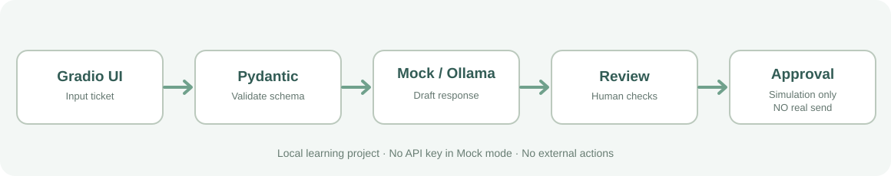

# 06 — Optional local AI lab: Gradio + Ollama

**This is after the 60-minute core**, not another compulsory lesson. Allow about **15–25 minutes** of hands-on work, plus any model download and first-run time.



## What you will build

A small **support-ticket reply assistant**, not an autonomous agent. The Gradio app lets you compare:

- **Mock**: deterministic classification, Pydantic input validation, async fake tools, no model and no network.
- **Ollama**: a real local LLM via HTTP `POST /api/chat`, JSON output validated by Pydantic.
- **Approval**: the app can simulate acceptance of a draft but **never** sends email or updates an external system.

## Step 1 — Install the demo dependencies

```bash
uv sync --group dev --group demo
```

## Step 2 — Start with no model, no API key

```bash
uv run --group demo python examples/gradio_app.py
```

Open the local URL that Gradio prints (normally `http://127.0.0.1:7860`). Select **Mock (no model)**, run the example, inspect the result and the approval gate. No Ollama installation is necessary for this mode.

## Step 3 — Optional: use an actual local model

1. Install [Ollama](https://ollama.com/download) on your machine.
2. Download a small model: `ollama pull llama3.2:1b`. It is approximately **1.3 GB**; downloading and inference speed depend on available hardware. If the server isn't running, start Ollama or use `ollama serve` in another terminal.
3. Choose **Ollama (local model)** in Gradio and retain the default model name `llama3.2:1b`.
4. Submit a fictional ticket and inspect the generated draft. Small models can be inconsistent: the application **validates output** and shows a clear error if the model responds with invalid JSON.

The API request remains on **`127.0.0.1:11434`** and the Gradio UI binds to **`127.0.0.1`** with `share=False`. Do not expose the local model or Gradio port publicly; test with fictional data only.

## Explore the Python skills

| File | What it demonstrates |
| --- | --- |
| `src/mini_agent/models.py` | Pydantic input models |
| `src/mini_agent/workflow.py` | Awaitable operations and coordination |
| `src/mini_agent/local_llm.py` | HTTP request/response, error handling, output validation |
| `examples/gradio_app.py` | UI components, callbacks, mode selection, approval simulation |
| `tests/test_local_llm.py` | Mocked HTTP tests that do not download a model |
| `tests/test_gradio_demo.py` | UI callback and build smoke tests |

**Challenge:** add a new ticket category with matching test coverage. Then deliberately break a model response in a unit test and confirm that Pydantic catches it.

## Troubleshooting

- **No Ollama connection:** verify Ollama is running; `ollama list` should show `llama3.2:1b`.
- **Model missing:** run `ollama pull llama3.2:1b`.
- **Slow responses:** try Mock mode first. Local CPU execution can be much slower than expected.
- **Invalid JSON:** switch to Mock, or try a more capable installed model; a local model's output is not guaranteed.
- **Port 7860 in use:** close another running Gradio instance; do not expose or share this UI.

References: [Ollama API](https://github.com/ollama/ollama/blob/main/docs/api.md) · [Gradio quickstart](https://www.gradio.app/guides/quickstart).

[Return to guide index](README.md)
