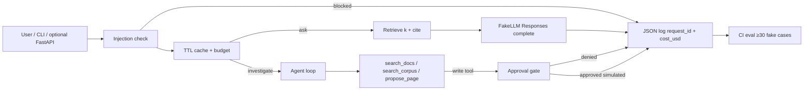

# DocsDesk v1.0 architecture

Alt text: A left-to-right pipeline. Optional FastAPI or the CLI enters an injection check, then a TTL cache and budget. Cache misses go to a numpy RAG index over the payments-api fixture (FakeEmbedder vectors) and a Responses-shaped FakeLLM that returns citations. Incidents instead enter the agent loop, which may call read-only tools freely and `propose_page` only after an approval flag. Every turn emits a JSON log line with `request_id` and `cost_usd`. A pytest CI gate runs ≥30 offline eval cases.

Java analog: a Spring Boot app with a web adapter, a security filter, a service, a repository, Micrometer, and Surefire. The misleading bit: the *model* proposes the next tool. Your Python still executes it.

Layers in code (`docsdesk.portfolio.architecture_layers`):

1. `http` — optional FastAPI (`docsdesk.service.create_app`). TestClient only in CI.
2. `security` — `classify_prompt` before any model call.
3. `budget` — remaining USD + TTL cache.
4. `rag` — FakeEmbedder + fixture vectors + citations.
5. `agent` — Module 5 loop, max steps, write-tool gate.
6. `observe` — ContextVar request id, JSON `cost_usd`.
7. `evals` — `run_v1_eval` as the merge gate.

No Assistants API. No bound `0.0.0.0`. No real wiki write.
